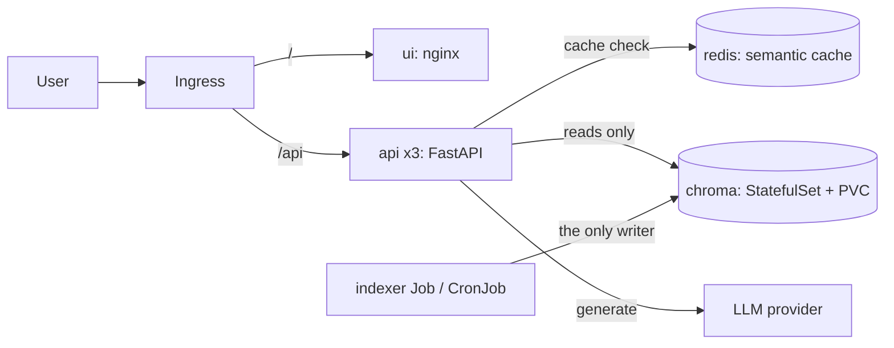

# RAHBAR: Grounded RAG on Kubernetes

[](https://github.com/Asifa-Minahil011/rahbar-starter/actions/workflows/ci.yml) [](https://github.com/Asifa-Minahil011/rahbar-starter/actions/workflows/cd.yml)

A question-answering service that answers only from a document corpus, cites its sources,
and abstains when the corpus does not cover the question. It runs on Kubernetes (minikube).

## Prerequisites
Docker, minikube, kubectl and make. On Windows, use WSL 2 (Ubuntu) with Docker Desktop's
WSL integration turned on.

## Run it from a clean clone
```bash
git clone <this repository> rahbar && cd rahbar

make cluster          # minikube with Calico (NetworkPolicy is enforced), metrics-server, ingress
make images           # build the api, ui and indexer images and load them into minikube
make apply            # namespace, config, chroma, redis, indexer Job, api, ui, ingress, HPA, policies
kubectl get pods -n rahbar -w     # wait: chroma, redis, 3 x api, ui Running; indexer Completed
```

Reach the Ingress. On Linux, `make ask` finds the address itself. On macOS or Windows (docker
driver), run this in a second terminal and leave it open:
```bash
minikube tunnel
```
Then ask a question:
```bash
make ask INGRESS_IP=127.0.0.1 Q="What is the attendance requirement?"
```

## Re-index without a redeploy
```bash
make index            # kubectl create job --from=cronjob/reindex ...
kubectl get jobs -n rahbar -w
```

## Secrets
Nothing secret is committed. If you use a hosted LLM (`LLM_PROVIDER=hosted`), create the Secret
from the command line, never from a file:
```bash
export LLM_API_KEY=...
make secret
```
`k8s/base/secret.placeholder.yaml` only documents the shape and is deliberately not applied.

## Corpus
The documents are not committed. See `docs/CORPUS.md` and `corpus/MANIFEST.md` (URLs and
SHA-256 checksums) and fetch them with `make fetch`.

## Documentation
Architecture decisions are in `docs/adr/`, the pipeline in `docs/PIPELINE.md`, failure analysis in
`docs/FAILURE-ANALYSIS.md`, engineering notes in `docs/ENGINEERING-NOTES.md`, and AI assistance
in `docs/AI-USAGE.md`.

<!-- rahbar-readme-extra -->
## Architecture

Two paths that never share a process: the indexer Job writes the vector store, the API only reads it.



## API

| Method | Path | Purpose |
| --- | --- | --- |
| GET | /healthz | liveness: the process is alive, touches no dependency |
| GET | /readyz | readiness: Chroma and Redis reachable, collection non-empty, embedding model matches |
| GET | /metrics | Prometheus metrics |
| POST | /api/ask | body `{"question": "..."}`; returns a cited, schema-validated answer, or abstains |

## Apply order

From a clean clone, in this order (`make cluster`, `make images` and `make apply` run these steps):

```bash
minikube start --driver=docker --cni=calico --memory=6144 --cpus=4   # Calico enforces NetworkPolicy
minikube addons enable metrics-server && minikube addons enable ingress
make images                                  # build the three images and load them into minikube
kubectl apply -k k8s/overlays/dev            # namespace, config, chroma, redis, indexer Job, api, ui, ingress, HPA, policies
kubectl get pods -n rahbar -w                # indexer Completed, everything else Running
minikube tunnel                              # second terminal on macOS/Windows
make ask INGRESS_IP=127.0.0.1 Q="..."        # ask through the Ingress
```

<!-- rahbar-deploy-modes -->
## What runs where

- **The committed manifests deploy the stub retriever and the dummy index** (`RETRIEVER=stub`,
  `EMBED_MODEL=dummy-768`, and the indexer runs with `--dummy`). That keeps CI and a clean-clone
  run independent of any model. In the cluster, `POST /api/ask` therefore returns three fixed
  stub passages, not grounded answers.
- **The real pipeline** (extraction with OCR, structure-aware chunking, `nomic-embed-text`
  embeddings, hybrid retrieval, grounded generation, the semantic cache) was run and measured
  on a developer machine with Ollama. The numbers are in `eval/results.json` and
  `eval/baseline.json`, and the tuning and failure experiments are in `docs/PIPELINE.md`,
  `docs/FAILURE-ANALYSIS.md` and `docs/evidence/measurement-run-summary.md`.
- **CI** runs lint, tests, manifest validation, an image scan and the eval gate. The gate applies
  `eval/run_eval.py`'s `gate()` to the committed results against the baseline. The live run,
  `make eval`, needs a running stack with Ollama.
- **Not done:** running the real pipeline inside the cluster. It needs the corpus mounted into
  the indexer Job and Ollama reachable from the pods.
